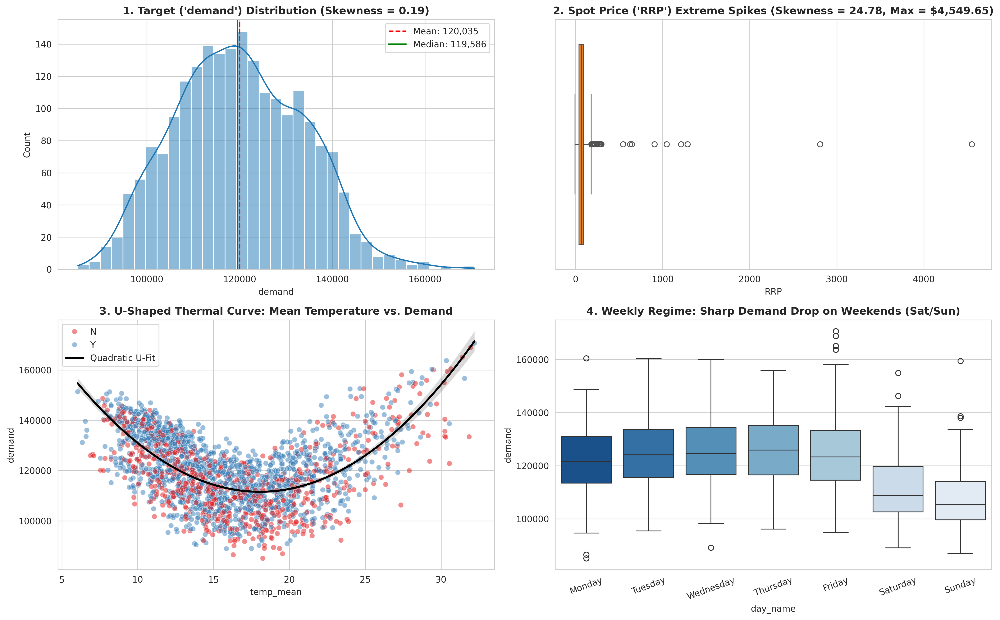
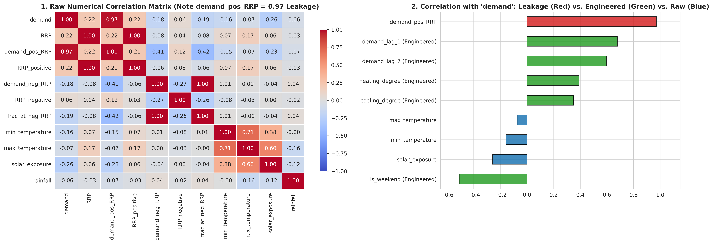

# ⚡ Victoria Daily Electricity Demand Forecasting
### Leak-Free End-to-End Machine Learning Pipeline & Interactive Streamlit Forecaster


An end-to-end, production-grade machine learning system for forecasting daily electricity demand (MWh) across Victoria, Australia. Built with custom Scikit-Learn transformers, chronological validation, automated MLflow experiment tracking, model card versioning, and an interactive Streamlit inference application.

---

## 📌 Executive Summary & Engineering Highlights

Forecasting grid-level electricity load requires capturing non-linear weather dynamics, calendar regime shifts, and autoregressive market memory without leaking future information. 

* **Strict Zero-Leakage Architecture:** Chronological train/validation/test partitioning is executed prior to any statistical fitting. All scalers, imputers, and outlier fences are learned exclusively on the training partition inside a modular `Pipeline` and `ColumnTransformer`.
* **Same-Day Settlement Leakage Elimination:** Raw dataset columns include post-settlement sub-demand variables (`demand_pos_RRP`, `demand_neg_RRP`) that sum to the daily target (`r = +0.97` linear correlation). Same-day settlement columns are stripped from day-$t$ inputs and converted strictly into causal historical lags ($t-1$).
* **Physics-Informed Feature Engineering:** Decomposes raw temperatures (which exhibit a misleading near-zero linear correlation due to opposing winter heating and summer cooling slopes) into U-shaped thermal proxies (`heating_degree`, `cooling_degree`, `temp_mean_sq`) and calendar-regime interactions.
* **Production Generalization:** The tuned **Voting Ensemble** (`Ridge` + `Random Forest` + `Gradient Boosting`) reduced validation error by more than half compared to a naive persistence baseline and generalized across the unseen 2019–2020 test period (including COVID-19 lockdown regime shifts).

---

## 🔬 Domain Analysis & Leakage Audit

### 1. Target Stability vs. Spot Price Volatility
Exploratory diagnostics across the unbroken 2,106-day series (January 2015 – October 2020) reveal why grid load (`demand`) is modeled directly while spot price (`RRP`) is treated as a lagged exogenous signal capped at the training upper fence:



* **Symmetric Physical Target:** Daily `demand` follows a well-behaved, near-normal distribution (`Mean = 120,035 MWh`, `Median = 119,586 MWh`, `Skewness = 0.19`).
* **Extreme Spot Price Spikes:** Recommended Retail Price (`RRP`) exhibits severe positive skewness (`24.78`) driven by summer generator outages and heatwave spikes reaching `$4,549.65 AUD/MWh`. To prevent prior-day price shocks from distorting linear and ensemble predictions, `RRP_lag_1` is clipped at the training IQR fence (`$178.27 AUD/MWh`) inside `DemandDomainEngineer.fit()`.
* **Non-Linear Thermal U-Curve & Weekly Regimes:** Electricity load rises sharply below `18°C` (heating load) and above `22°C` (cooling load), while dropping by `12,000–18,000 MWh` on Saturdays and Sundays.

### 2. Correlation Audit: Exposing Target Leakage & Non-Linearity
A standard linear Pearson correlation matrix on raw features is deceptive in energy forecasting:



* **Why Same-Day Settlement Columns Must Be Dropped:** `demand_pos_RRP` correlates at `+0.97` with `demand` because total demand is the accounting sum of positive-RRP and negative-RRP demand. Leaving same-day settlement variables in `X` creates artificial target leakage.
* **Unlocking Thermal Signals:** Raw `max_temperature` (`r = -0.07`) and `min_temperature` (`r = -0.16`) cancel out linearly across the U-curve. Engineering `heating_degree` (`r = +0.39`), `cooling_degree` (`r = +0.35`), `is_weekend` (`r = -0.51`), `demand_lag_1` (`r = +0.68`), and `demand_lag_7` (`r = +0.60`) exposes strong causal signals.

---

## 🏗️ Modular Pipeline Architecture

```text
Raw CSV (2,106 Days)
  │
  ├─► 1. Causal Time-Series Initializer
  │      ├── Chronological sort & continuity check (0 missing calendar days)
  │      ├── Causal forward-fill (ffill) on weather (solar_exposure, rainfall)
  │      ├── Historical lag extraction (t-1, t-2, t-7, t-14, 7-day rolling mean/std)
  │      └── Removal of same-day post-settlement leakage columns
  │
  ├─► 2. Chronological Partitioning (Shuffle = False)
  │      ├── Train : 2015-01-01 ──► 2019-01-13 (1,474 days | 70%)
  │      ├── Val   : 2019-01-14 ──► 2019-11-25 (  316 days | 15%)
  │      └── Test  : 2019-11-26 ──► 2020-10-06 (  316 days | 15%)
  │
  └─► 3. Scikit-Learn Production Pipeline (Fit strictly on X_train)
         ├── DemandDomainEngineer (Custom BaseEstimator & TransformerMixin)
         │     ├── Learns RRP_lag_1 IQR fence ($178.27) strictly from X_train
         │     ├── Cyclical month encoding (sin / cos) & weekend indicator
         │     ├── U-curve thermal degree days & quadratic temperature terms
         │     └── Regime interactions (holiday_x_temp, school_x_temp, weekend_x_demand_lag1)
         ├── Selective ColumnTransformer (47 Final Features)
         │     ├── Numerics (25 cols)     ─► SimpleImputer(median) + StandardScaler
         │     ├── Categoricals (4 cols)  ─► SimpleImputer(most_frequent) + OneHotEncoder
         │     └── Binary Flag (1 col)    ─► Passthrough (is_weekend)
         └── Tuned Estimator (VotingRegressor: Ridge + RandomForest + GradientBoosting)
```

---

## 📊 Experimental Results & Model Leaderboard

All models were tracked with **MLflow**, evaluated on the chronological validation split, cross-validated using 5-fold `TimeSeriesSplit`, and tuned via `RandomizedSearchCV`.

| Model | Val RMSE (MWh) | Val MAE (MWh) | Val MAPE (%) | Val R² |
| :--- | :---: | :---: | :---: | :---: |
| **Voting Ensemble (Tuned Champion)** | **4,168.30** | **3,218.45** | **2.73%** | **0.9051** |
| XGBoost Regressor | 4,160.21 | 3,206.64 | 2.71% | 0.9055 |
| Gradient Boosting | 4,355.78 | 3,380.22 | 2.86% | 0.8964 |
| HistGradientBoosting | 4,379.45 | 3,292.18 | 2.79% | 0.8952 |
| Random Forest | 4,698.48 | 3,622.18 | 3.07% | 0.8794 |
| Ridge Regression | 5,978.98 | 3,786.27 | 3.18% | 0.8047 |
| Naive Persistence (`demand[t-1]`) | 10,692.29 | 7,664.28 | 6.48% | 0.3756 |
| Seasonal Weekly Naive (`demand[t-7]`) | 13,737.71 | 9,646.24 | 8.04% | -0.0308 |

### Final Unseen Test Set Evaluation (Nov 2019 – Oct 2020)

| Evaluation Split | Champion Model | RMSE (MWh) | MAE (MWh) | R² Score |
| :--- | :--- | :---: | :---: | :---: |
| **Unseen Test Set (316 Days)** | **Tuned Voting Ensemble** | **5,063.05** | **4,027.09** | **0.8647** |
| Unseen Test Set (316 Days) | Naive Baseline (`t-1`) | 11,173.61 | 8,010.65 | 0.3412 |
| Unseen Test Set (316 Days) | Seasonal Naive (`t-7`) | 13,283.79 | 9,632.11 | 0.0688 |

---

## 🚀 Quickstart & Reproduction

### 1. Clone & Install Dependencies (via `uv` or `pip`)
```bash
git clone [https://github.com/](https://github.com/)<your-username>/victoria-electricity-demand-forecasting.git
cd victoria-electricity-demand-forecasting

# Option A: Using uv (Fastest & reproducible via uv.lock)
uv sync

# Option B: Using standard venv + pip
python -m venv .venv
source .venv/bin/activate
pip install scikit-learn xgboost pandas numpy matplotlib seaborn mlflow streamlit joblib
```

### 2. Launch the Interactive Streamlit Forecaster
```bash
uv run streamlit run app.py
# Or with standard venv:
python -m streamlit run app.py
```

### 3. Inspect MLflow Experiment Logs (Optional)
```bash
mlflow ui --backend-store-uri file://$(pwd)/mlruns
```

---

## 👤 Author
**Ibrahim Mohamed Ibrahim Hamid**  
Electrical & Electronics Engineering | Machine Learning & Autonomous Systems
